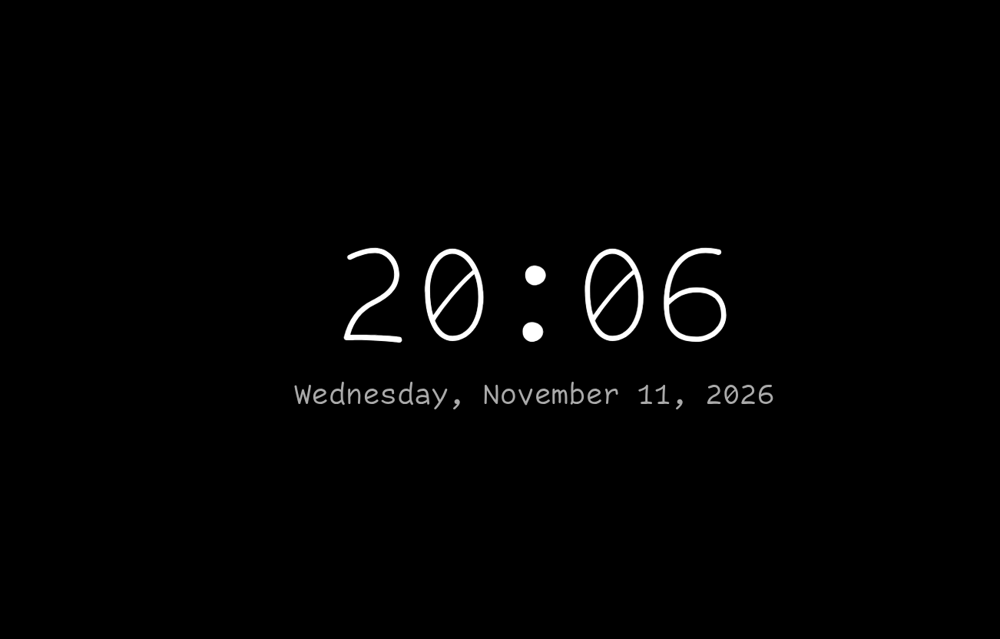

# Black Clock

Chrome new tab. Black background, date and time. Nothing else. That's it.

## Install

1. Open `chrome://extensions`.
2. Enable Developer mode.
3. Click Load unpacked, select this folder.
